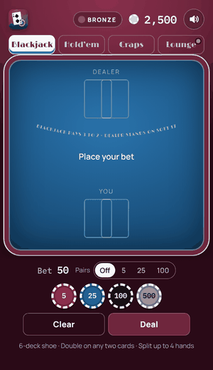
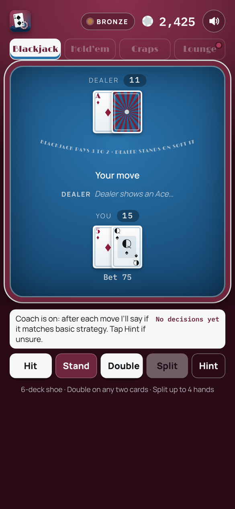
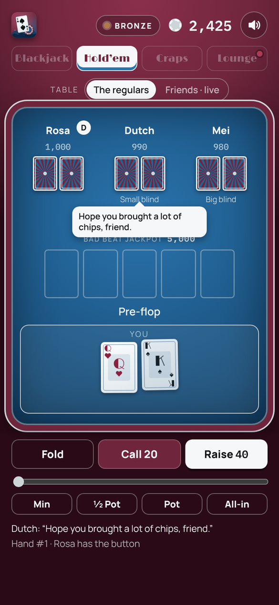
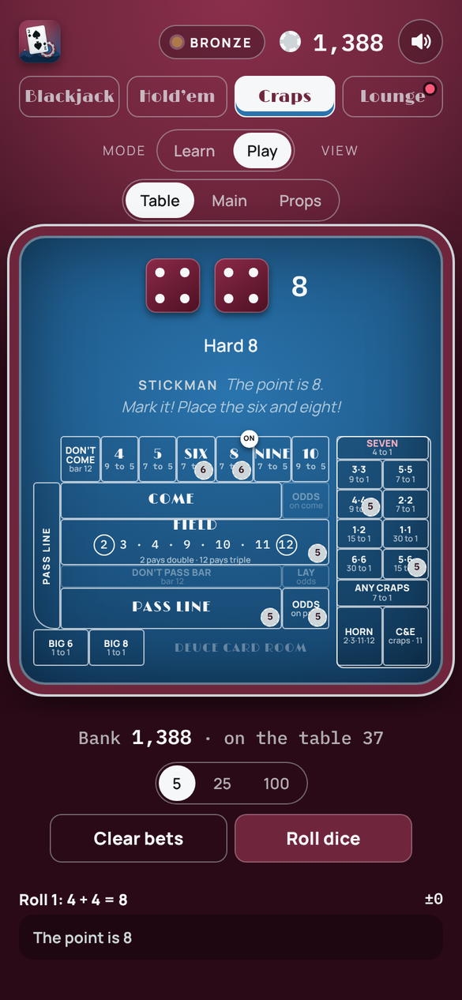
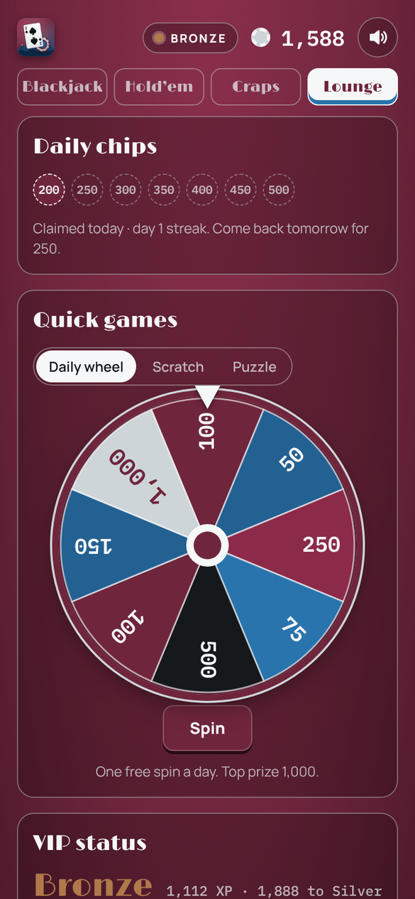

# Deuce Card Room

[](https://github.com/Cody-Ayers/deuce-card-room/actions/workflows/test.yml)

Blackjack, Texas Hold'em and Craps in one installable web app, dressed in burgundy and steel blue.

**▶ Play:** https://cody-ayers.github.io/deuce-card-room/

<p align="center"></p>

| Blackjack | Hold'em | Craps | Lounge |
| --- | --- | --- | --- |
|  |  |  |  |

## What's inside
- **Blackjack:** 6-deck shoe, splits and doubles, a Perfect Pairs side bet, and a **basic-strategy coach** that grades every decision and keeps a running accuracy score
- **Texas Hold'em:** three regulars (Rosa, Dutch and Mei) with their own playing styles. They estimate their odds by simulating the rest of the hand, talk at the table, and remember you between visits. There's also a bad beat jackpot.
- **Craps:** the full casino layout on one screen, including every line, place, odds, hardway and proposition bet. Learn mode has an 11-step lesson and explains every roll bet by bet.
- **Lounge:** VIP levels with unlockable felts, card backs and higher stakes, daily chips with streaks, 20 achievements, personal records with a bank chart, a prize wheel, scratch cards and a daily Hold'em puzzle

## Under the hood
- **No framework, no build step.** It's one `index.html` with hand-written CSS and JavaScript. Sound effects are synthesized with the Web Audio API.
- **Installable PWA:** a manifest and service worker let it go on your home screen and play offline.
- **A separate game engine:** the rules and math live in a `<script id="engine">` block with no access to the page: blackjack totals and basic strategy, a 7-card poker evaluator and equity estimator, and craps settlement for every bet.
- **Tested:** 46 tests load that engine straight out of `index.html`, so they check the exact code the app runs. They run on every push with GitHub Actions.

```bash
npm test   # Node 20+, no dependencies
```

## Accounts and friends
Sign in from the Lounge to back up your progress to the cloud and pick it up on any device. Signed-in players share a leaderboard and a brag wall, and can sit down together at a live Hold'em table. It runs on [Supabase](https://supabase.com): Postgres tables with row-level security for saves and player cards (`supabase/schema.sql`), and Realtime presence for the live table. Signed out or offline, everything else still works. Players can delete their account and data from the Lounge, and the [privacy policy](privacy.html) explains what's stored.

## Native app (iOS)
The same game builds as a native iPhone app with Capacitor, with fonts and libraries bundled so it runs offline. See [docs/IOS.md](docs/IOS.md).

## Install on your phone
- **iPhone (Safari):** Share → Add to Home Screen
- **Android (Chrome):** menu → Install app

Signed out, progress is saved on each device.

## Files
| File | What it does |
| --- | --- |
| `index.html` | The whole app: engine, interface and styles |
| `manifest.webmanifest` | App name, colors and icons for installing |
| `sw.js` | Service worker for offline play and fresh updates |
| `cloud.js` | Supabase sign-in, cloud saves, leaderboard and live-table presence |
| `supabase/schema.sql` | Tables, access rules and the account-deletion function to run once in Supabase |
| `privacy.html` | Privacy policy |
| `capacitor.config.json`, `scripts/build-www.mjs` | Native app config and the build that bundles fonts and libraries into `www/` |
| `assets/`, `fonts/` | App icon and launch screen sources, bundled fonts (SIL OFL) |
| `tests/` | Engine tests (blackjack, poker, craps) |
| `icons/` | App icon in every size, plus the source SVG |
